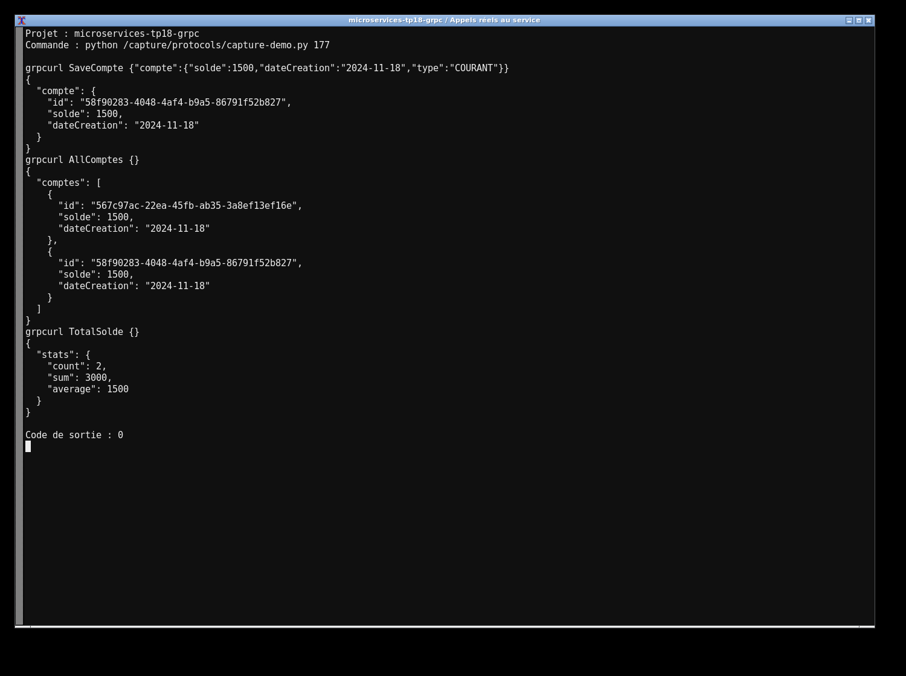
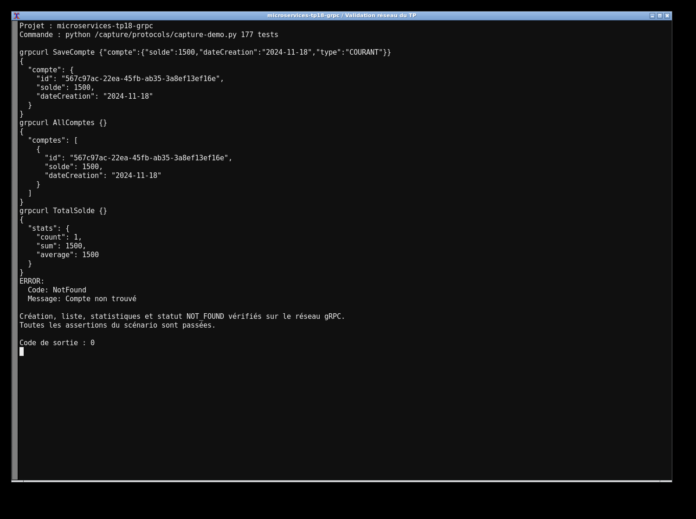

# TP18 — Banque gRPC

Le fichier `CompteService.proto` définit les quatre appels du TP : AllComptes, CompteById, SaveCompte et TotalSolde. Maven génère réellement les messages Protobuf et les stubs Java. Le service utilise Spring Data JPA et H2 ; le profil `memory` conserve aussi la première étape avec ConcurrentHashMap.

```bash
mvn clean verify
mvn spring-boot:run
# Dans un autre terminal
mvn exec:java -Dexec.mainClass=ma.projet.grpc.client.ClientDemo
```

Le serveur gRPC écoute sur `localhost:9090`. Le contrat peut être importé dans BloomRPC ou grpcurl. Le client Java fourni crée puis consulte un compte avec les stubs générés. Les erreurs utilisent les statuts gRPC NOT_FOUND et INVALID_ARGUMENT.

J’utilise Java 17, Boot 3.2.4, le starter 3.1.0 et gRPC 1.63.0 : ce sont les versions compatibles du starter. Protobuf est aligné sur 3.25.3 pour la génération. Les huit tests couvrent les appels réseau, les statistiques, la persistance, les erreurs et la sérialisation.



